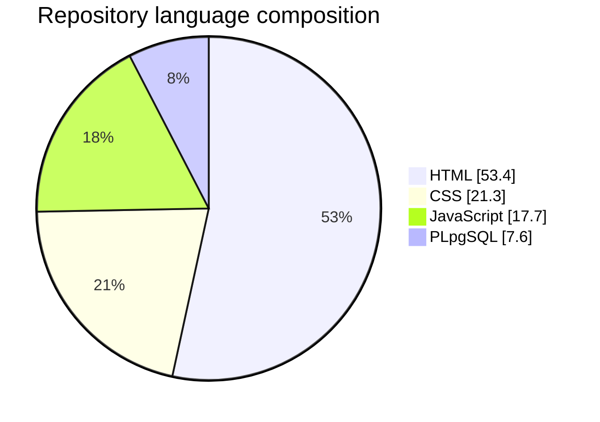
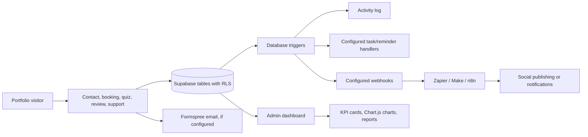
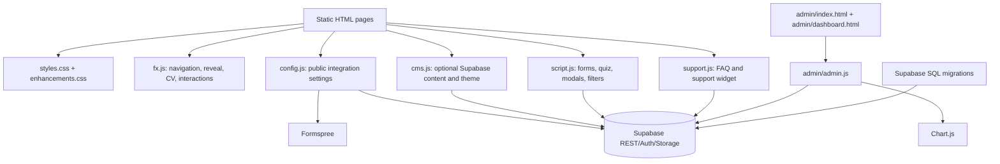

<div align="center">
  
  <h1>Uchenna Godswill · Portfolio</h1>
  <p><strong>Data · Design · Development · Agile</strong></p>
  <p>A responsive, multi-page portfolio and lightweight content platform for presenting work, gathering enquiries, and managing site content.</p>
  <p>
    <a href="https://github.com/cupidnavaz/my-professional-portfolio"></a>
    
    
    
  </p>
</div>

<p align="center">
  <a href="#-overview">Overview</a> ·
  <a href="#-features">Features</a> ·
  <a href="#-admin-dashboard">Admin dashboard</a> ·
  <a href="#-quick-start">Quick start</a> ·
  <a href="#-deployment">Deployment</a> ·
  <a href="#-configuration">Configuration</a>
</p>

---

## ✨ Overview

This repository is Uchenna Godswill's professional portfolio and the public-facing site for **CupidCreativeX Ventures**. It brings profile and credentials, service offerings, categorized case studies, reviews, consultation booking, and contact options together in one static-first website. An optional Supabase-backed admin panel adds content management, lead tracking, operational analytics, and automation without introducing a custom application server.

The site is built with plain HTML, CSS, and browser JavaScript. It has **no package manager, framework, or build step**: publish the repository's root directory as-is. Supabase and Formspree integrations are configurable; when email delivery is unavailable, the public forms provide a `mailto:` fallback where implemented.

### Live repository widgets

These cards are generated by GitHub readme-stats from the repository metadata. They are third-party hosted images and may be unavailable if that service is rate-limited.

<p align="center">
  <a href="https://github.com/cupidnavaz/my-professional-portfolio"></a>
  
</p>

> The repository's language widget describes source composition; it is not visitor or business analytics. Actual portfolio traffic and enquiry charts are available in the optional admin dashboard after its Supabase setup.

## 📊 Project snapshot

<table>
  <tr>
    <td align="center"><strong>8</strong><br>Built-in public pages</td>
    <td align="center"><strong>7</strong><br>Service disciplines</td>
    <td align="center"><strong>8</strong><br>Seeded case studies</td>
    <td align="center"><strong>3</strong><br>Primary enquiry forms</td>
    <td align="center"><strong>7 / 30 / 90</strong><br>Analytics date-range options</td>
  </tr>
</table>

The page count is the homepage plus About, Ventures, Services, Projects, Credentials, Reviews, and Contact. The case-study count refers to the starter records in `supabase-admin.sql`; the project list can be changed through the admin panel. The three enquiry forms are general contact, consultation booking, and the project-scoping quiz. Reviews are a separate feedback flow.

### Language composition



### Service cards

| Discipline | What the portfolio presents |
| --- | --- |
| 💻 Web & App Development | Responsive websites, web apps, API integration, and performance work |
| 🤖 Generative AI Services | Assistants, workflow automation, prompt engineering, and model integration |
| 🎨 UI/UX Design | Research, wireframes, prototypes, design systems, and usability testing |
| 📊 Data Analytics & Insights | Dashboards, SQL/ETL, Power BI or Looker, and KPI reporting |
| 🖌️ Graphics Design | Logos, brand guides, marketing collateral, and social assets |
| 🧭 Digital Consultation | Technology audits, roadmaps, vendor selection, and process design |
| 📣 Digital Marketing | SEO, content strategy, paid campaigns, and analytics |

## 🧭 Site map

| Page | Purpose | Notable interactions |
| --- | --- | --- |
| [`index.html`](index.html) | Portfolio home, featured work, services, process, venture, reviews, and contact | Animated profile orbit, statistic counters, project quiz, bio card, review and booking tabs |
| [`about.html`](about.html) | Profile, mission, career timeline, objectives, CV, and credential preview | Bio-card tabs, CV preview/download, credentials preview |
| [`ventures.html`](ventures.html) | CupidCreativeX Ventures and client/social proof | Venture links and contact actions |
| [`services.html`](services.html) | Full descriptions of the seven service disciplines | Project quiz and consultation call to action |
| [`projects.html`](projects.html) | Case studies grouped by discipline | Category filters, case-study modal, image carousel, project quiz |
| [`credentials.html`](credentials.html) | Qualifications, certifications, and recommendations | Credential filters and recommendation submission |
| [`reviews.html`](reviews.html) | Testimonials and review collection | Interactive star rating and submission form |
| [`contact.html`](contact.html) | Contact, reviews, and consultation booking | Switchable panels, contact form, booking form |
| [`page.html`](page.html) | Runtime template for CMS-created pages | Loads the published page selected by `?p=<slug>` |
| [`admin/`](admin/) | Admin login and protected content dashboard | CRUD screens, charts, media library, site settings, and automation tools |

## 🚀 Features

<details open>
  <summary><strong>Public portfolio and presentation</strong></summary>

- Dark, gradient-led visual system with responsive layouts, reusable design tokens, and a mobile navigation menu.
- Profile, career timeline, skills, venture information, and CV preview/download.
- Seven service detail cards and a four-stage **Analyze → Design → Develop → Deliver** process.
- Project gallery organized into Data Analytics, Web & App Development, UI/UX Design, and Branding & Graphics.
- Detailed project views with client, duration, request, challenge, solution, results, tools, and carousel controls.
- Credentials and recommendations pages, including visitor-submitted recommendations that require admin approval.
- Testimonials, interactive five-star review form, and responsive contact/booking panels.
- Floating support widget with searchable FAQs, support tickets, email, phone, WhatsApp, and booking shortcuts.
- Optional theme, branding, social links, fonts, colors, layout, and animation settings managed in the admin panel.
</details>

<details>
  <summary><strong>Lead capture and visitor interactions</strong></summary>

- **Five-step project quiz:** choose one or more services, select feature needs, budget and timeline, add project details and contact information, then review and submit. The submission is saved to `quiz_leads` when Supabase is configured and sent through Formspree when configured.
- **Consultation booking:** collect name, email, preferred date/time, and a note; save to `bookings` and send an email using the configured integrations.
- **Contact form:** save messages to `contact_messages` and attempt email delivery.
- **Reviews:** collect a star rating, name, optional role/company, and testimonial; load persisted reviews when Supabase is enabled.
- **Recommendations:** accept public recommendations into a moderation queue; only approved entries are displayed.
- **Support tickets:** searchable FAQs plus a message form, with a honeypot field and input limits enforced by the database policy.
- **Fallback behavior:** forms that use `script.js` can offer a prefilled email-app link if Formspree is missing or fails. The project quiz's final action opens a prepared email; it does not claim that a message was delivered unless Formspree confirms it.
</details>

<details>
  <summary><strong>Admin content management</strong></summary>

The admin interface at `/admin/` is intentionally not linked in the public navigation. After authentication and database setup, manage:

- Projects, services, reviews, bookings, project leads, and contact messages.
- Per-record status, private notes, publishing/approval state, and featured projects.
- Site settings, social profiles, brand identity, theme, fonts, colors, and animation preferences.
- Page text, links and images; visibility of existing sections; custom pages and custom sections.
- Credentials, recommendations, support FAQs, support tickets, CV, and media uploads.
- Plugins such as Google Analytics 4, Meta Pixel, Tawk.to, custom CSS, and custom JavaScript.
- Webhook endpoints and event subscriptions, queued social posts, task/reminder records, and event handlers.
</details>

## 📈 Admin dashboard: KPI cards, charts, and widgets

The optional admin dashboard is a real data-backed operational view (`admin/admin.js`), not just an illustrative README graphic. It uses Chart.js and Supabase queries. Its date-range selector supports **7, 30, and 90 days**, with period comparisons where data is available.

### KPI cards

| KPI card | Data source / interpretation |
| --- | --- |
| Page views | Tracked visits in `page_views` for the selected period |
| Bookings | Booking records created in the period |
| Project leads | Project quiz submissions in the period |
| Messages | Contact-form messages in the period |
| Average rating | Ratings from review records in the period |
| Conversion | Bookings + leads + messages divided by tracked views |
| Open tasks | Tasks not marked done |
| Reminders due | Reminders not completed and due now |

### Dashboard chart cards

| Chart | Visualization | What it shows |
| --- | --- | --- |
| Traffic & inquiries | Time-series line chart | Page views and enquiry volume over the selected range |
| Inbox status | Doughnut chart | Enquiry status distribution |
| Top pages | Bar chart | Most-viewed paths in the current period |
| Feature activity | Bar chart | Bookings, leads, messages, reviews, and social-post activity |

Additional dashboard widgets include a **task advisor**, upcoming reminders, recent activity, report tables, printable reports, and CSV export. The advisor checks for overdue follow-ups, tasks/reminders due, traffic changes, missing project images, unpublished projects, unapproved reviews, inactive webhooks, and disabled analytics. It can turn recommendations into follow-up tasks.

> Charts and live KPIs require the corresponding optional SQL migrations and data. A newly configured project can show empty/zero series until visitors and submissions generate records. Browser-based view tracking is a lightweight first-party counter, not a substitute for a full analytics platform.

### Automation flow



## 🧩 How the application fits together



### Request and content flow

1. The browser serves static HTML, CSS, and JavaScript directly from the hosting provider.
2. `fx.js` initializes shared navigation, scroll progress/reveal, CV preview, and tab interactions.
3. `script.js` initializes page-specific interactions and form submissions. `config.js` supplies the public Supabase URL/key and Formspree endpoint; `cms.js` enhances built-in HTML with published Supabase content when configured.
4. Public submissions use Supabase's anon key and database policies. The admin uses Supabase Auth and the `is_admin()` check; SQL row-level security is the data protection boundary.
5. Optional database triggers record activity, invoke event handlers, and send configured webhooks. `admin/admin.js` reads the resulting records for inboxes, KPIs, charts, reports, and reminders.

## 🛠️ Technology

| Layer | Technologies |
| --- | --- |
| Front end | HTML, CSS, vanilla JavaScript; responsive CSS and browser APIs such as `IntersectionObserver` |
| Database / API | Supabase Postgres, REST API, Auth, Storage, row-level security, and PL/pgSQL functions/triggers |
| Charts | Chart.js 4.4.4 in the admin dashboard |
| Email | Formspree, with mail-app fallback paths in supported forms |
| Hosting | Netlify or GitHub Pages; static root publish, no build command |
| Optional automation | Supabase `pg_net`, `pg_cron`, and outbound webhooks to tools such as Zapier, Make, or n8n |

## ⚡ Quick start

### Run the static site locally

There is no dependency installation or compilation. From the repository root, start a local static server:

```bash
python3 -m http.server 8000
```

Then open <http://localhost:8000>. If Python is unavailable, use any static file server. Opening HTML directly with `file://` may prevent browser integrations from behaving as they do on a served site.

### Configure public forms and content

1. Open `config.js` and set your Formspree endpoint and Supabase project URL plus **anon/public** key.
2. In your Supabase project's SQL Editor, run `supabase.sql` to create the public submission tables.
3. For the admin panel, follow the ordered setup in [Supabase setup](#-supabase-database-and-admin-setup).
4. Set up Formspree separately if you want server-confirmed email delivery. Keep its endpoint appropriate for this public site.
5. Replace the placeholder `assets/cv.pdf` or upload a real CV and set `cv_url` in Admin → Appearance.

Without Supabase, the static portfolio and built-in HTML remain available; database-backed content, analytics, login, and persistence require configuration. Without Formspree, applicable form flows fall back to an email app rather than server email delivery.

## 🔐 Supabase database and admin setup

Run SQL files in the following order in the Supabase SQL Editor. The base/admin/features/dashboard sequence is required for the full dashboard and automation; the remaining migrations enable their named optional features.

| Order | SQL file | Adds |
| --- | --- | --- |
| 1 | [`supabase.sql`](supabase.sql) | Reviews, bookings, quiz leads, contact messages, and public insert policies |
| 2 | [`supabase-admin.sql`](supabase-admin.sql) | Admin allowlist/function, projects, services, settings, moderation and inbox policies, starter content |
| 3 | [`supabase-features.sql`](supabase-features.sql) | Plugins, webhooks, social posts, `pg_net` integration, and public media bucket |
| 4 | [`supabase-dashboard.sql`](supabase-dashboard.sql) | Activity log, page views, tasks, reminders, event handlers, and optional `pg_cron` schedule |
| 5 | [`supabase-pages.sql`](supabase-pages.sql) | Credentials and moderated recommendations |
| 6 | [`supabase-content.sql`](supabase-content.sql) | Editable page content, custom pages, and custom sections |
| 7 | [`supabase-support.sql`](supabase-support.sql) | Support FAQs and tickets; run after dashboard SQL for ticket event triggers |
| Optional | [`supabase-project-media.sql`](supabase-project-media.sql) | Optional project URL and project gallery fields |

### Create the first admin

1. Replace `YOUR_ADMIN_EMAIL` in `supabase-admin.sql` with the email you will use to sign in, then run that SQL migration.
2. In Supabase Authentication, create a user with that same email and a strong password.
3. Disable public user sign-ups in Supabase Auth settings.
4. Confirm the email is present in the `admins` table and the site's Supabase URL/anon key are configured in `config.js`.
5. Visit `/admin/` and sign in. The dashboard checks both the authenticated session and `is_admin()`.

**Security:** the Supabase anon/publishable key is intended for browser use, but it is not an authorization mechanism. Keep the Supabase **service-role key** and other private secrets out of `config.js`, HTML, JavaScript, and this repository. Review row-level security policies before adding tables or public write access. The hidden admin URL is not security; the database policies and admin allowlist provide the access control.

### Optional automation notes

- Configure webhook rows in Admin → Webhooks and select event names such as `booking.created`, `message.created`, `lead.created`, `review.created`, `ticket.created`, `reminder.due`, or `post.publish` as applicable.
- To deliver scheduled reminder/task webhooks, enable the Supabase `pg_cron` extension if available to your project. The migration attempts to schedule `process_reminders()` every five minutes and reports a notice if the extension is unavailable.
- Social posting is delegated through webhooks: queued posts publish a `post.publish` event for your automation provider. The static website does not safely store third-party social-network credentials.
- Enable only integrations you use. Plugins may load third-party scripts or custom code on public pages.

## 🚢 Deployment

### Netlify

- Connect the GitHub repository or drag the project folder into Netlify Drop.
- **Build command:** none.
- **Publish directory:** `.` (repository root).
- [`netlify.toml`](netlify.toml) sets the publish directory, `/admin` redirect, cache rules, and admin response headers.

### GitHub Pages

1. Push the site to a GitHub repository.
2. Open **Settings → Pages** and choose **Deploy from a branch**.
3. Select the publishing branch and `/(root)` folder.
4. Wait for the Pages deployment, then open the URL GitHub provides.

The site uses relative asset and page links, so it can be served from a repository subpath. Supabase authentication redirect URLs, Formspree configuration, and any allowed-origin settings must also match the deployed domain.

## ⚙️ Configuration reference

| File | Responsibility |
| --- | --- |
| [`config.js`](config.js) | Shared Formspree endpoint, Supabase URL/public key, and loading of `enhancements.css` |
| [`script.js`](script.js) | Form requests, fallback links, counters, filters, quiz, booking, review, and project/profile modals |
| [`cms.js`](cms.js) | Published content, page tracking, site settings/theme, custom pages/sections, credentials, and recommendations |
| [`fx.js`](fx.js) | Mobile navigation, scroll progress/reveal, interactive card motion, CV preview, credential and content tabs |
| [`support.js`](support.js) | FAQ search, ticket form, contact methods, and admin-managed support settings |
| [`styles.css`](styles.css) | Main visual system, responsive layouts, cards, animations, forms, and modal styling |
| [`admin/admin.js`](admin/admin.js) | Admin authentication guard, content/inbox editors, KPI cards, Chart.js reports, reminders, and task advisor |
| `supabase-*.sql` | Database schema, policies, triggers, initial content, and optional dashboard/content features |
| [`netlify.toml`](netlify.toml) | Static hosting configuration and response headers |

### Current starter content to review

- `assets/cv.pdf` is identified in the project documentation as a placeholder; replace it before publishing a real CV link.
- Social profile links, media-kit link, profile details, and some sample testimonial/client content should be reviewed and replaced with approved, accurate information.
- The profile's visible numerical counters and the review page's sample rating/count are authored page content, not all derived from database analytics. Update those values to match your real and current data.
- `config.js` contains public-facing integration settings. Replace sample project-specific settings with your own and keep private credentials server-side.

## ♿ Accessibility and motion

The interface includes labeled navigation controls, focus-visible styling, form labels, modal dialog semantics, keyboard Escape handling, and reduced-motion CSS for many animations. The motion preference is also checked in `fx.js`. When extending UI, preserve keyboard access, meaningful labels, readable contrast, and the reduced-motion behavior.

## 🗂️ Repository layout

```text
.
├── index.html                 Home page
├── about.html                 Profile, experience, CV, credentials preview
├── ventures.html              CupidCreativeX Ventures and social proof
├── services.html              Seven service descriptions and delivery process
├── projects.html              Categorized portfolio and case-study dialogs
├── credentials.html           Credentials and recommendations
├── reviews.html               Testimonials and review form
├── contact.html               Contact, review, and booking panels
├── page.html                  Supabase-powered custom-page template
├── 404.html                   Not-found page
├── styles.css                 Main styles and responsive visual system
├── enhancements.css           Shared visual polish
├── script.js                  Public interactions and submission handlers
├── fx.js                      Shared navigation, reveal, tabs, and CV behavior
├── cms.js                     Optional database-backed content and theme
├── support.js                 Customer-support widget
├── config.js                  Public integration configuration
├── admin/                     Admin login, dashboard, styles, and scripts
├── assets/                    Logos, images, and CV placeholder
├── supabase*.sql              Base schema and optional feature migrations
└── netlify.toml               Netlify static-site configuration
```

## 🤝 Contributing / editing content

This is a personal portfolio. For a tailored deployment, update the static page content and assets, configure the public integrations, and apply only the Supabase migrations needed for the features you intend to use. Admin-managed content can be changed in the dashboard after database setup. Keep the starter copy, customer data, and sample figures accurate and authorized before publishing.

## 📄 License

No explicit license file is present in the repository. Contact the repository owner before redistributing or reusing its content and assets.

---

<div align="center">
  <sub>Built with HTML, CSS, JavaScript, Postgres, and a focus on bringing data, design, and delivery together.</sub>
</div>
